

<a href="https://www.luizrenato.dev"></a>

 

 

**Engenheiro de Software e IA** com 9 anos construindo sistemas de verdade, com dados, automação e agentes de IA trabalhando junto do time. 
Uno a precisão de quem vive de BI e Analytics com a entrega de quem desenvolve Full Stack de ponta a ponta.

 


 


 


 

<a href="https://www.luizrenato.dev/#projetos"></a>

 

<a href="https://www.luizrenato.dev/#projetos"></a>
<a href="https://www.luizrenato.dev/#projetos"></a>
<a href="https://www.luizrenato.dev/#projetos"></a>
<a href="https://www.luizrenato.dev/#projetos"></a>

 

<a href="https://www.luizrenato.dev">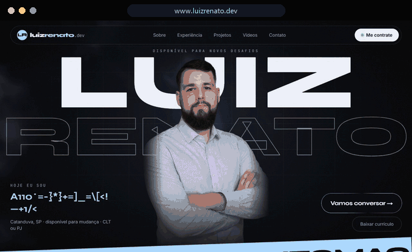</a>

 


 


 

<a href="https://www.luizrenato.dev/#contato"></a>

 

